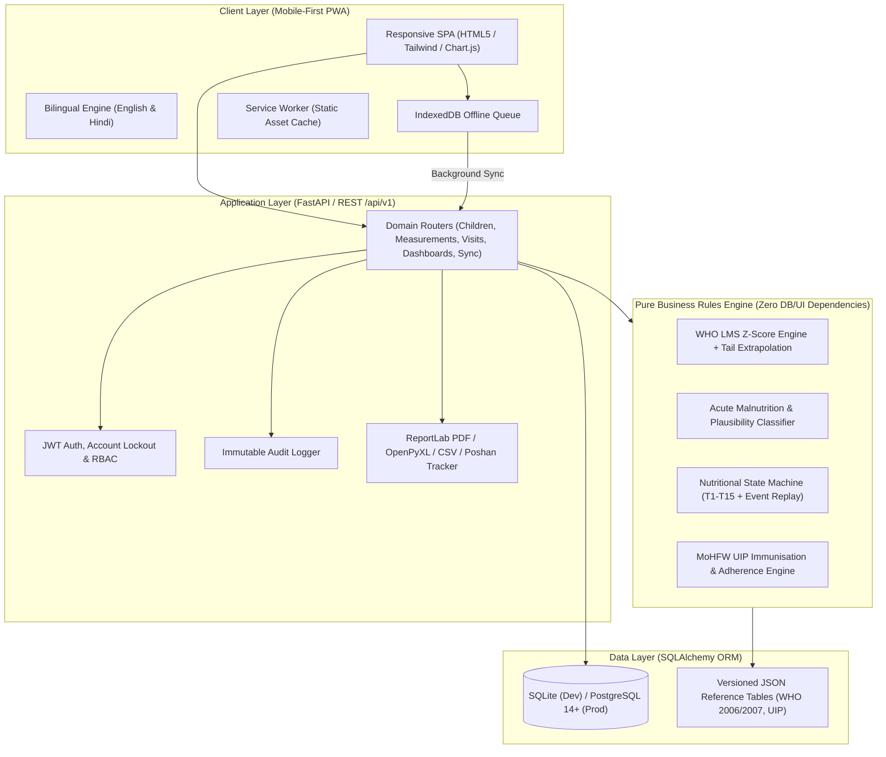
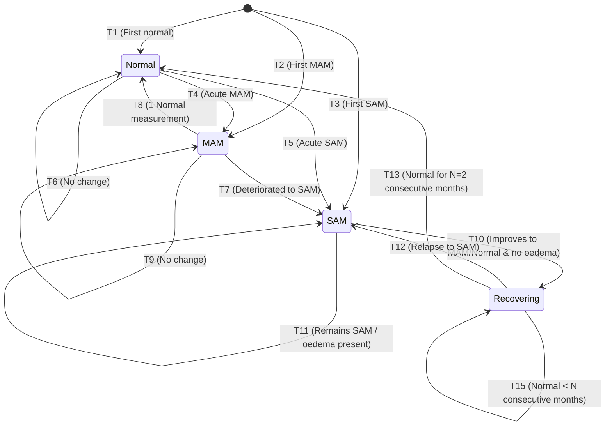

# ACGMS System Architecture

## 1. Layered Architecture

The **Anganwadi / ICDS Child Growth Monitoring System (ACGMS)** follows a strict 4-tier modular architecture designed for offline-first rural deployment and deterministic clinical accuracy:

---

## 2. Pure Business Rules Engine (`backend/app/rules/`)

Per **FR-ZS-05** and **NFR-09**, all clinical and mathematical rules live in stateless pure Python modules with zero database or web framework dependencies:

### 2.1 WHO LMS Z-Score Computation (`zscore.py`)
For an anthropometric value $X$ and sex/age (or length/height) parameters $L, M, S$:
- If $L \neq 0$: $z = \frac{(X / M)^L - 1}{L \times S}$
- If $L = 0$: $z = \frac{\ln(X / M)}{S}$

**WHO Extreme Tail Extrapolation ($|z| > 3$)** for Weight-for-Age (WAZ) and Weight-for-Height (WHZ):
- Upper tail ($z > 3$): $z^* = 3 + \frac{X - SD3_{pos}}{SD3_{pos} - SD2_{pos}}$
- Lower tail ($z < -3$): $z^* = -3 + \frac{X - SD3_{neg}}{SD2_{neg} - SD3_{neg}}$

**Posture Correction (FR-GM-03)**:
- Age $< 24$ months measured standing $\rightarrow$ $+0.7\text{ cm}$
- Age $\ge 24$ months measured lying down $\rightarrow$ $-0.7\text{ cm}$

### 2.2 Nutritional Status State Machine (`state_machine.py`)

**Critical Invariant**: A `SAM` child can **never** transition directly to `Normal`; they must pass through `Recovering` (`T10` followed by `T13`).

---

## 3. Role-Based Access Control (RBAC) Matrix

| Role | Jurisdiction Scope | Key Capabilities |
| :--- | :--- | :--- |
| **AWW** | Assigned AWC | Register children, record measurements & vaccines, view/acknowledge AWC alerts |
| **LS** | Assigned Sector (group of AWCs) | Review sector AWCs, conduct & PDF-export inspection visits, handle 7-day escalated SAM alerts |
| **CDPO** | Assigned Block (Project) | Block-level malnutrition dashboards, ranked AWCs, 14-day escalated SAM alerts, exports |
| **DPO** | Assigned District | Cross-block comparison, district surveillance dashboards, masked exports |
| **ADMIN** | Global | Master hierarchy, WHO/UIP reference versioning, system thresholds, full access |
